# Customer Segmentation Using Unsupervised Machine Learning

Segmenting 440 wholesale distributor clients by their annual spending patterns, using K-Means, Agglomerative Clustering, and DBSCAN. This was the final project for the IBM Unsupervised Machine Learning course.


---

## Table of Contents

1. [Project Overview](#1-project-overview)
2. [Business Problem](#2-business-problem)
3. [Dataset](#3-dataset)
4. [Technologies and Libraries](#4-technologies-and-libraries)
5. [Exploratory Data Analysis](#5-exploratory-data-analysis)
6. [Data Preprocessing](#6-data-preprocessing)
7. [Clustering Algorithms](#7-clustering-algorithms)
8. [Model Comparison](#8-model-comparison)
9. [PCA Visualization](#9-pca-visualization)
10. [Final Customer Segments](#10-final-customer-segments)
11. [Business Insights and Recommendations](#11-business-insights-and-recommendations)
12. [Limitations](#12-limitations)
13. [Installation and Usage](#13-installation-and-usage)
14. [Repository Structure](#14-repository-structure)
15. [References](#15-references)

---

## 1. Project Overview

The goal of this project is to find natural customer groups in a wholesale distributor's client base using only annual spending data. There is no target label, so the problem is treated as unsupervised clustering.

**Workflow:** data quality checks → exploratory analysis → log transformation and standard scaling → K-Means, Agglomerative Clustering, and DBSCAN → model comparison using silhouette score and interpretability → PCA visualization → segment profiling and business interpretation.

**Result:** K-Means with **K = 3** was selected as the final model. It produced three segments of **80, 147, and 213 customers** with a silhouette score of **0.259**.

> **Note on choosing K:** K = 2 has a higher silhouette score (0.290) than K = 3 (0.259). K = 3 was chosen for **business interpretability**: it separates a high-value, broad-spending group from two groups with distinct product preferences. It was *not* chosen because it maximized the silhouette score. See [Section 7.1](#71-k-means-clustering).

## 2. Business Problem

A wholesale distributor serves a mix of hotels, restaurants, cafés (Horeca) and retail clients, and these clients buy very different product mixes. Treating them as one group makes marketing, account management, and stock planning less effective.

**Question:** *Can wholesale customers be grouped into useful business segments based on their spending patterns?*

Segments like these can help with:
- **Marketing:** targeted promotions and product bundles for each segment
- **Customer relationship management:** deciding which accounts get priority service
- **Inventory planning:** stocking to match the category demand of each segment

## 3. Dataset

| Item | Value |
|---|---|
| Name | Wholesale customers |
| Source | [UCI Machine Learning Repository, dataset #292](https://archive.ics.uci.edu/dataset/292/wholesale+customers) |
| Creator | Margarida Cardoso (2013) |
| License | [CC BY 4.0](https://creativecommons.org/licenses/by/4.0/) |
| Rows / columns | 440 / 8 |
| Missing values | 0 |
| Duplicate rows | 0 |

| Column | Description |
|---|---|
| `Channel` | 1 = Horeca (Hotel/Restaurant/Café), 2 = Retail |
| `Region` | 1 = Lisbon, 2 = Oporto, 3 = Other |
| `Fresh` | Annual spending (monetary units) on fresh products |
| `Milk` | Annual spending on milk products |
| `Grocery` | Annual spending on grocery products |
| `Frozen` | Annual spending on frozen products |
| `Detergents_Paper` | Annual spending on detergents and paper products |
| `Delicassen` | Annual spending on delicatessen products |

Clustering uses only the **six spending features**. `Channel` and `Region` are used afterwards to profile the segments.

The dataset is included in this repository as `wholesale_customers.csv` under the terms of its CC BY 4.0 license (see [References](#15-references) for attribution).

## 4. Technologies and Libraries

| Purpose | Tools |
|---|---|
| Language / environment | Python 3, Jupyter Notebook (developed in Google Colab) |
| Data handling | pandas, NumPy |
| Visualization | matplotlib, seaborn |
| Machine learning | scikit-learn (`StandardScaler`, `KMeans`, `AgglomerativeClustering`, `DBSCAN`, `PCA`, `NearestNeighbors`, `silhouette_score`) |
| Hierarchical clustering | SciPy (`linkage`, `dendrogram`) |

## 5. Exploratory Data Analysis

- The dataset has 440 complete records with no missing values or duplicate rows.
- Region distribution: Other = 316, Lisbon = 77, Oporto = 47.
- All six spending features are **strongly right-skewed**: most customers spend modest amounts and a few spend very large amounts. Skewness ranges from 2.56 (Fresh) to 11.15 (Delicassen).
- The correlation heatmap shows a strong relationship between **Grocery and Detergents_Paper** (r = 0.92) and between **Grocery and Milk** (r = 0.73).

| Raw spending distributions | Correlation between features |
|---|---|
| 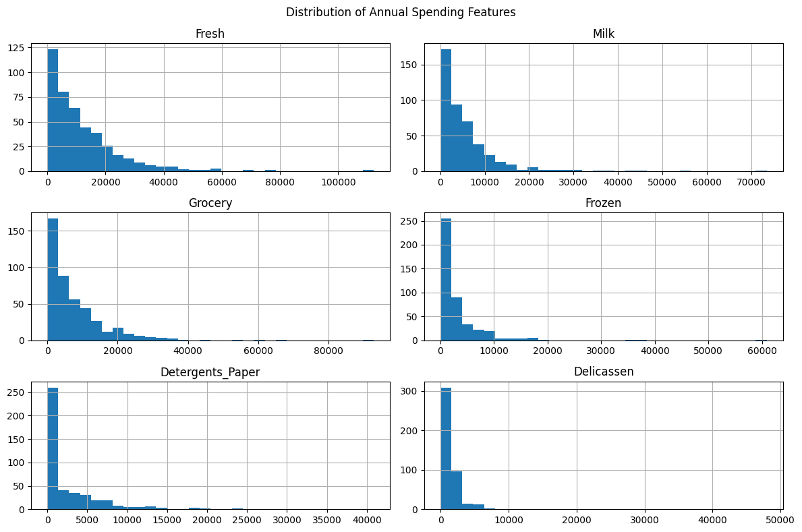 | 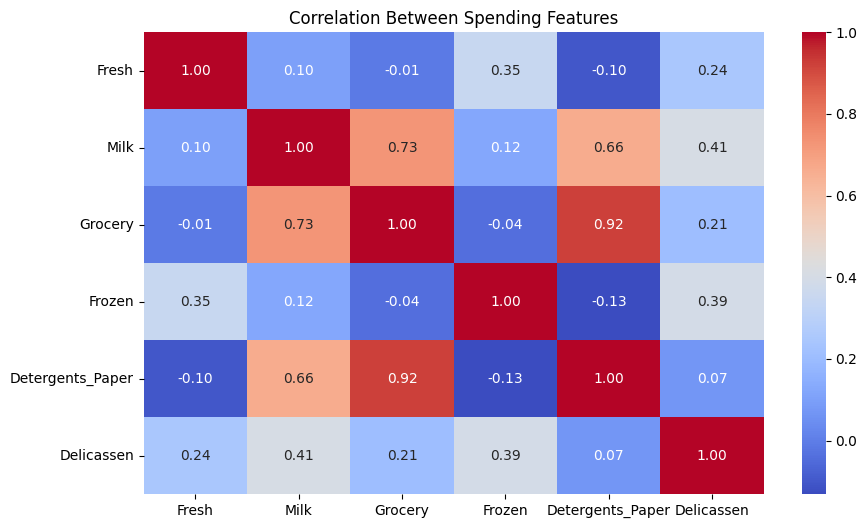 |

## 6. Data Preprocessing

K-Means, Ward linkage, and DBSCAN all rely on distances, so skewed features with different scales would distort the results. Two steps were applied:

1. **Log transformation:** `np.log1p(x)` to reduce the influence of extreme values
2. **Standardization:** `StandardScaler` so each feature has mean 0 and standard deviation 1

| Feature | Skewness before | Skewness after log |
|---|---:|---:|
| Fresh | 2.56 | −1.58 |
| Milk | 4.05 | −0.22 |
| Grocery | 3.59 | −0.67 |
| Frozen | 5.91 | −0.35 |
| Detergents_Paper | 3.63 | −0.24 |
| Delicassen | 11.15 | −1.09 |

<p align="center">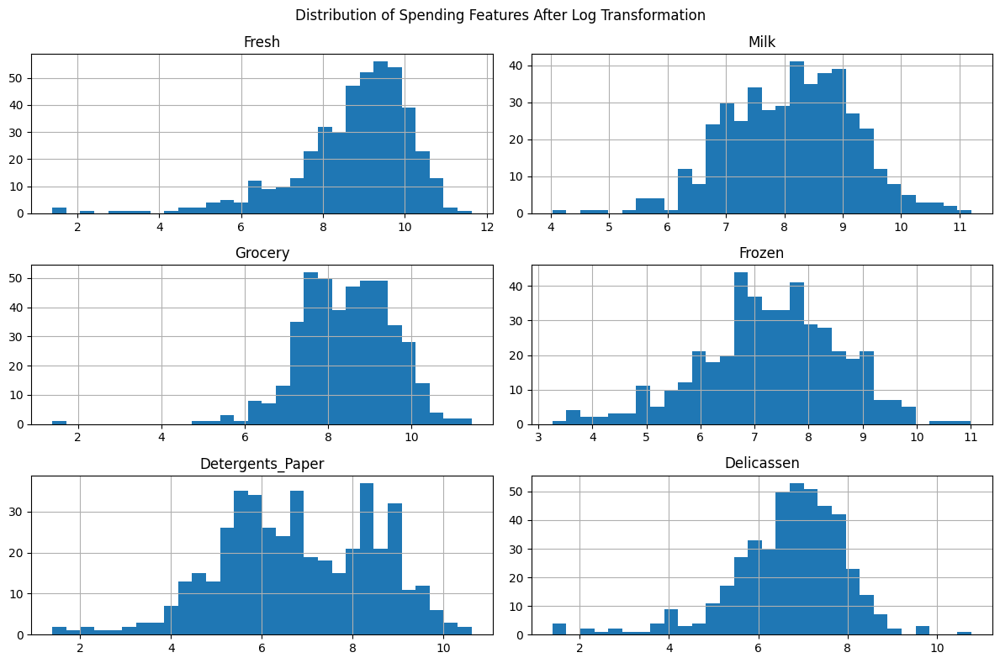</p>

## 7. Clustering Algorithms

### 7.1 K-Means Clustering

K was tested from 2 to 10 (`random_state=42`, `n_init=10`) and evaluated with the elbow method (inertia) and the silhouette score.

| K | Inertia | Silhouette |
|---:|---:|---:|
| **2** | 1844.06 | **0.290** |
| **3** | 1553.42 | **0.259** |
| 4 | 1386.86 | 0.188 |
| 5 | 1266.15 | 0.192 |
| 6 | 1174.76 | 0.201 |
| 7 | 1086.36 | 0.196 |
| 8 | 1028.49 | 0.185 |
| 9 | 973.14 | 0.197 |
| 10 | 932.00 | 0.191 |

| Elbow method | Silhouette score by K |
|---|---|
| 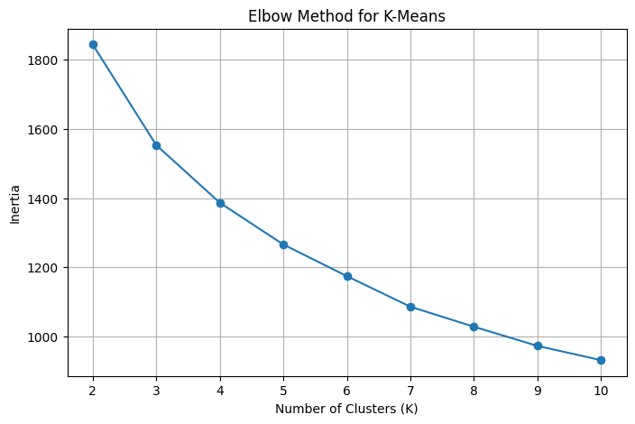 | 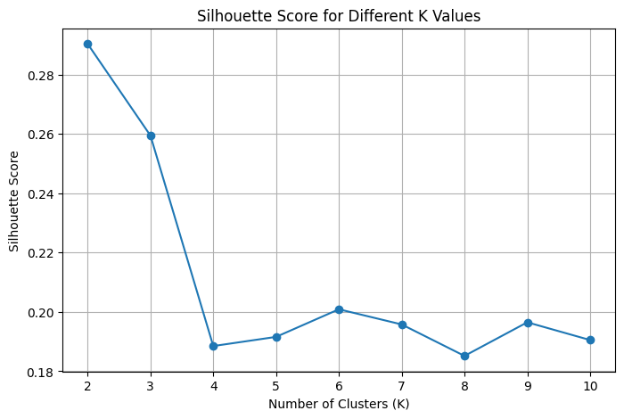 |

**Why K = 3 rather than K = 2:** K = 2 gives the highest silhouette score. A two-way split, however, gives limited guidance for marketing and inventory decisions. K = 3 still has the second-best score, well above K ≥ 4, and it produces three segments that are clearly different and easy to act on (Section 10). The choice is a deliberate trade-off between a small loss in cluster separation and better business interpretability.

### 7.2 Agglomerative Hierarchical Clustering

Ward linkage was used, with the number of clusters tested from 2 to 10. The silhouette score was 0.258 at K = 2 and 0.255 at K = 3. K = 3 was used in the final comparison to match K-Means. Cluster sizes were 262, 53, and 125.

<p align="center">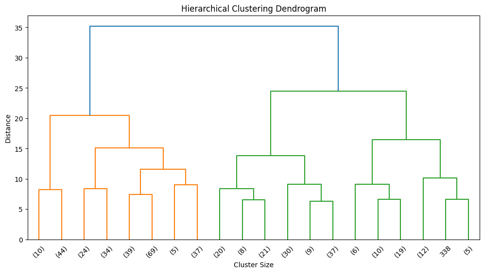</p>

### 7.3 DBSCAN

DBSCAN was tested on a grid of `eps` ∈ {0.5, 0.7, 0.9, 1.1, 1.3, 1.5} and `min_samples` ∈ {3, 5, 7}, supported by a k-distance plot. The configuration carried into the comparison (`eps=1.1`, `min_samples=5`) produced **one dense cluster of 344 customers and 96 noise points**. That makes DBSCAN useful for flagging unusual customers but not suitable for segmenting the whole customer base. With only one non-noise cluster, the silhouette score is not defined.

## 8. Model Comparison

| Model | Final parameters | Clusters | Noise points | Silhouette score | Assessment |
|---|---|---:|---:|---:|---|
| **K-Means** ✅ | K = 3, `random_state=42` | 3 | 0 | **0.259** | Best score at K = 3; all customers assigned; easy to interpret |
| Agglomerative | K = 3, Ward linkage | 3 | 0 | 0.255 | Close second; less balanced cluster sizes (262 / 53 / 125) |
| DBSCAN | `eps=1.1`, `min_samples=5` | 1 | 96 | Not applicable | One cluster plus noise; better suited to outlier detection |

<p align="center">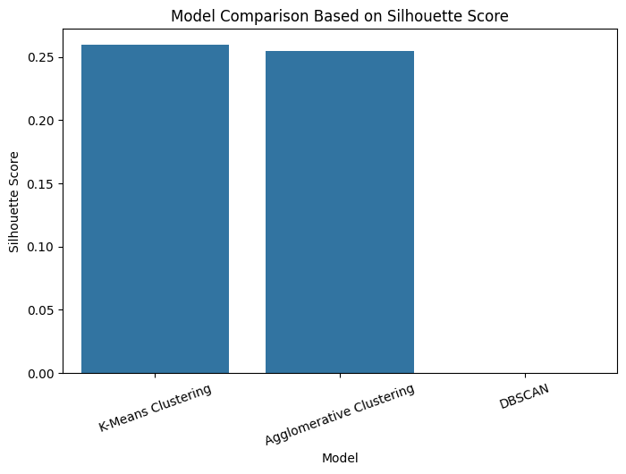</p>

The DBSCAN bar is empty because its silhouette score is undefined for a single cluster.

**Selected model:** K-Means with K = 3.

## 9. PCA Visualization

PCA reduced the six scaled features to two components **for visualization only**. Clustering was done on all six features.

- PC1 explains **44.08%** of the variance
- PC2 explains **27.19%**
- Together: **71.27%**

<p align="center">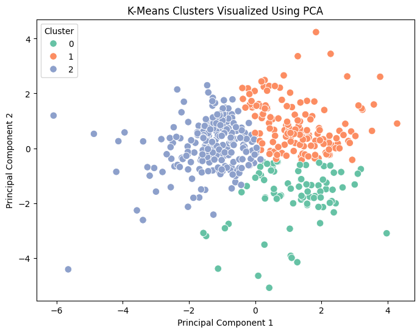</p>

The three K-Means clusters occupy mostly separate regions of the PCA plane, with some overlap at the boundaries. This overlap is consistent with a moderate silhouette score of 0.259.

## 10. Final Customer Segments

| Segment | Name | Customers | Share | Channel mix (Horeca / Retail) | Avg. total annual spending |
|---|---|---:|---:|---|---:|
| 0 | Retail grocery-focused | 80 | 18.18% | 40% / 60% | 29,548 |
| 1 | High-value broad spenders | 147 | 33.41% | 38% / 62% | 52,903 |
| 2 | Fresh-focused traditional | 213 | 48.41% | 99% / 1% | 21,028 |

**Average annual spending by segment (monetary units):**

| Segment | Fresh | Milk | Grocery | Frozen | Detergents_Paper | Delicassen |
|---|---:|---:|---:|---:|---:|---:|
| 0 | 2,899 | 7,136 | 12,570 | 607 | 5,554 | 783 |
| 1 | 17,043 | 10,560 | 13,334 | 4,133 | 4,987 | 2,847 |
| 2 | 11,939 | 2,006 | 2,502 | 3,266 | 424 | 891 |

| Spending profile by segment | Spending index (segment mean ÷ overall mean) |
|---|---|
| 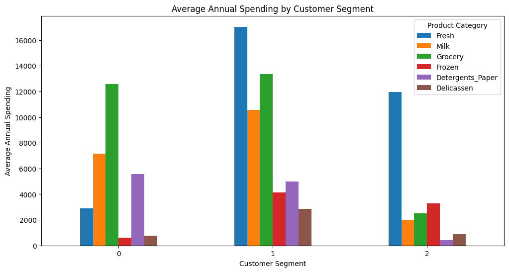 | 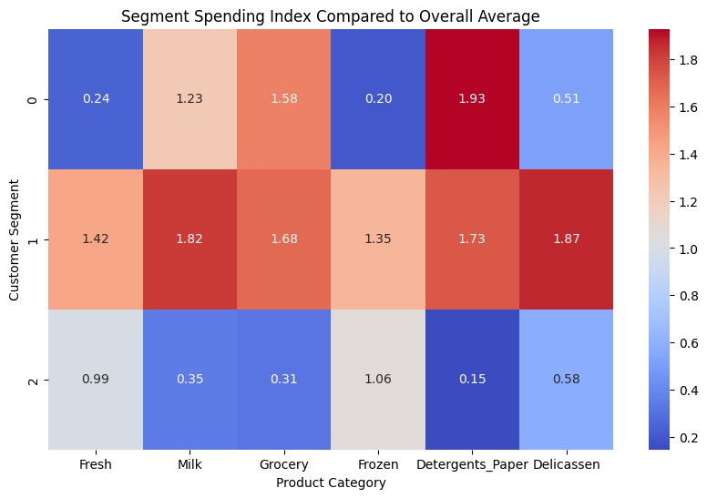 |

- **Segment 0, Retail grocery-focused (80 customers).** Spending is concentrated in Grocery, Milk, and Detergents_Paper. Detergents_Paper is at 1.93× the overall average and Grocery at 1.58×. Fresh (0.24×) and Frozen (0.20×) are very low.
- **Segment 1, High-value broad spenders (147 customers).** This segment spends above average in **every** category (index 1.35×–1.87×) and has the highest total spending.
- **Segment 2, Fresh-focused traditional (213 customers).** This is the largest segment and is almost entirely Horeca (98.6%). Fresh and Frozen spending are near the overall average, while Grocery, Milk, and Detergents_Paper are well below it.

<p align="center">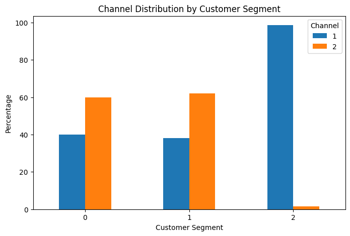</p>

The segment names are interpretive labels based on these spending profiles.

## 11. Business Insights and Recommendations

| Segment | Marketing | Customer relationship management | Inventory planning |
|---|---|---|---|
| **0: Retail grocery-focused** | Grocery, milk, and detergents/paper bundles; frequent-purchase promotions | Retention programs for regular replenishment buyers | Prioritize packaged and replenishable goods |
| **1: High-value broad spenders** | Cross-selling and broad product offers | Priority account management and premium service | Keep wide availability across all categories |
| **2: Fresh-focused traditional** | Upselling into complementary categories (e.g., Frozen, Delicassen) | Reliability and freshness guarantees for Horeca clients | Plan fresh-product supply and bulk fresh offers |

These segments are a **starting point**. They should be validated with business stakeholders before major decisions are based on them.

## 12. Limitations

- **Limited features.** The data covers annual spending, channel, and region only. It has no profitability, order frequency, customer size, or loyalty information.
- **No ground truth.** As with any unsupervised analysis, there are no labels to confirm the clusters are "correct".
- **Moderate cluster separation.** A silhouette score of 0.259 shows real but overlapping structure, not sharply separated groups.
- **K chosen with judgment.** K = 3 was chosen for interpretability over the higher-scoring K = 2.
- **Preprocessing sensitivity.** Other choices, such as outlier removal or feature weighting, could change cluster assignments.
- **DBSCAN grid scores.** In the DBSCAN parameter search, `silhouette_score` was computed with noise points (label −1) included as their own group. Those grid scores are therefore not directly comparable with the K-Means and Agglomerative scores.
- **Single dataset snapshot.** 440 customers from one distributor in Portugal; the results may not generalize.

**Possible next steps:** add transaction-level and profitability data, run cluster stability analysis (e.g., bootstrapping), and test other methods such as Gaussian Mixture Models.

## 13. Installation and Usage

```bash
# 1. Clone the repository
git clone https://github.com/abdelrhmanmohamedxx/customer-segmentation-unsupervised-learning.git
cd customer-segmentation-unsupervised-learning

# 2. (Optional) create a virtual environment
python -m venv .venv
source .venv/bin/activate        # Windows: .venv\Scripts\activate

# 3. Install dependencies
pip install -r requirements.txt

# 4. Launch the notebook
jupyter notebook customer_segmentation.ipynb
```

Run all cells from top to bottom. The notebook reads `wholesale_customers.csv` from the repository root. K-Means and PCA use `random_state=42`, so results are reproducible.

**Reproducibility check:** all code cells were re-executed in order in a fresh Python 3.13 environment (pandas 3.0, NumPy 2.5, scikit-learn 1.9, matplotlib 3.11, seaborn 0.13, SciPy 1.18). Every reported metric and cluster size reproduced exactly.

To run in **Google Colab**, upload the notebook and `wholesale_customers.csv` to the same session.

## 14. Repository Structure

```
customer-segmentation-unsupervised-learning/
├── README.md                     # Project documentation
├── customer_segmentation.ipynb   # Full analysis notebook (with outputs)
├── wholesale_customers.csv       # UCI Wholesale customers dataset (CC BY 4.0)
├── final_report.pdf              # Final analytical report
├── requirements.txt              # Python dependencies
├── LICENSE                       # MIT License (code only)
├── .gitignore
└── images/                       # Charts exported from the notebook for this README
```

## 15. References

- Cardoso, M. (2013). *Wholesale customers* [Dataset]. UCI Machine Learning Repository. https://doi.org/10.24432/C5030X. Licensed under [CC BY 4.0](https://creativecommons.org/licenses/by/4.0/).
- Pedregosa, F. et al. (2011). Scikit-learn: Machine Learning in Python. *Journal of Machine Learning Research*, 12, 2825–2830.
- scikit-learn documentation: [Clustering](https://scikit-learn.org/stable/modules/clustering.html), [PCA](https://scikit-learn.org/stable/modules/decomposition.html#pca), [Silhouette score](https://scikit-learn.org/stable/modules/generated/sklearn.metrics.silhouette_score.html)
- IBM Unsupervised Machine Learning course (Coursera)

## License

- **Code** (`customer_segmentation.ipynb`): [MIT License](LICENSE)
- **Dataset** (`wholesale_customers.csv`): not covered by the MIT License. It was created by Margarida Cardoso and is distributed under [CC BY 4.0](https://creativecommons.org/licenses/by/4.0/) via the [UCI Machine Learning Repository](https://archive.ics.uci.edu/dataset/292/wholesale+customers). The file is redistributed unmodified.

---

**Author:** [Abdelrhman Mohamed](https://github.com/abdelrhmanmohamedxx)
